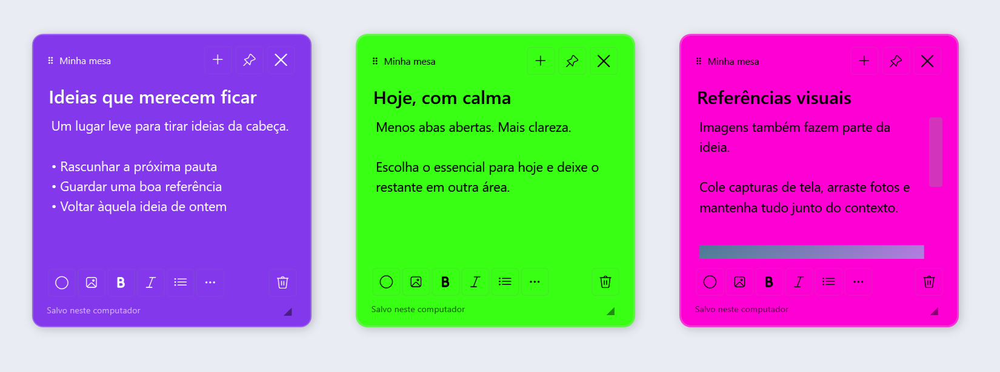
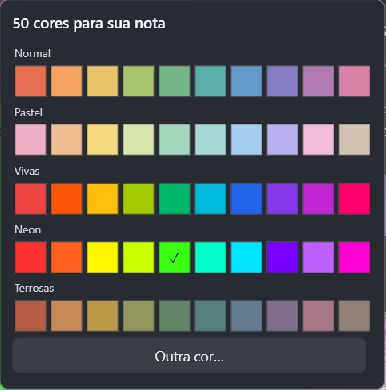

# Windows Sticky Notes

[Releases](https://github.com/showmetech/windows-sticky-notes/releases) · [Privacidade](PRIVACY.md) · [Fluxo de publicação](docs/PUBLISHING.md)

Notas adesivas para Windows 11, com a mesma base visual dos widgets de áudio e calendário: Segoe UI Variable, tema Fluent, cabeçalho de 64 px, ações de 32 px, cantos de 8 px, materiais translúcidos e animação de abertura/recolhimento de 240 ms que respeita as preferências do Windows.

## Widget e configurações da suíte · 1.3.0

O widget de 360 px reúne áreas, busca, notas e lixeira. As configurações abrem em uma janela da mesma largura, acoplada acima do widget com intervalo de 12 px. A altura se adapta ao monitor. Aparência e inicialização, áreas, dados/backup e atalhos ficam em grupos expansíveis, com navegação por teclado e botão de rolagem no rodapé.

O alfinete do widget o mantém aberto; o alfinete de cada nota continua independente. Sem fixar, o widget recolhe ao mudar para outro app, após 20 segundos sem interação, ou ao abrir outro widget compatível da suíte. Esse recolhimento não oculta nem exclui as notas da mesa. Enquanto configurações ou o menu estão em uso, o widget permanece aberto. Esc recolhe a janela atual e Ctrl+, abre configurações. Há acesso direto às configurações na faixa superior de cada nota.

A bandeja usa a integração nativa do Windows, com ícone próprio, ativação por mouse/teclado e recriação do ícone após reinício do Explorer. O aplicativo não cria janela principal na barra de tarefas. `--settings` abre as configurações; `--startup` inicia apenas a bandeja.

## Usar

- **Clique no ícone da bandeja:** traz as notas da área ativa para frente, nas posições salvas, e abre/recolhe o widget. Não cria botões na barra de tarefas.
- **Botão direito na bandeja:** nova nota, mostrar/ocultar, notas e áreas, grade, configurações e sair.
- **Arraste pela faixa superior**, ao lado dos botões, para posicionar a nota livremente na área de trabalho. A posição continua salva ao reabrir. Arraste o canto inferior direito para redimensionar.
- **Edite o título e escreva no corpo.** Ctrl+B e Ctrl+I formatam o texto; o botão de lista insere marcadores.
- **Imagens:** cole com Ctrl+V, arraste um arquivo para o corpo ou use o botão de imagem. A imagem é incorporada à nota: o arquivo original pode ser movido depois. Imagens grandes são reduzidas para até 1.600 pixels de largura; arquivos de até 30 MB. Formatos dependem dos decodificadores presentes no Windows; PNG e JPEG são as opções mais seguras.
- **Cor:** clique na amostra colorida e escolha entre **50 cores**, organizadas em cinco linhas de dez: **Normal**, **Pastel**, **Vivas**, **Neon** e **Terrosas**, ou uma cor personalizada. Vivas e Neon preservam a saturação mesmo no tema escuro; o texto alterna automaticamente entre preto e branco para manter contraste. Cores automáticas evitam as já usadas pelas notas ativas, inclusive as escolhidas manualmente.
- **Alfinete:** mantém a nota acima das outras janelas. Sem fixar, a nota continua aberta e pode ficar atrás dos seus aplicativos.
- **X ou Esc:** oculta a nota; não a exclui. O clique na bandeja a traz de volta. Ctrl+Shift+H oculta todas.
- **Áreas:** crie áreas em Configurações e selecione a área ativa em Notas e áreas. No menu da nota, escolha “Mover para outra área”. São grupos próprios do app, não áreas de trabalho virtuais do Windows.
- **Lixeira:** use o botão à direita da barra inferior, alinhado com os demais controles ou o menu “Mais opções”. Ambos pedem confirmação; Cancelar é a ação padrão. A nota só é movida após confirmar “Excluir nota” e pode ser restaurada pelo painel. Esta versão não faz exclusão definitiva nem esvazia a lixeira automaticamente.

## Instalação e dados

O aplicativo é instalado por usuário, sem administrador, em `%LOCALAPPDATA%\Programs\WindowsStickyNotes`. A inicialização automática abre apenas a bandeja. É possível desativá-la nas configurações. Há um atalho no menu Iniciar e nenhuma criação de atalho na área de trabalho.

Escolha o pacote x64 para Intel/AMD ou ARM64 para Windows em ARM. Pacote portátil: extraia o ZIP inteiro e abra `app\WindowsStickyNotes.exe`. Para instalar, execute `Install.ps1` com PowerShell. Não é necessário instalar o .NET: o runtime da arquitetura escolhida acompanha o executável. O pacote portátil não tem assinatura digital. A publicação na Microsoft Store depende de cadastro aprovado, identidade oficial e certificação; consulte o estado da release, sem presumir que já está disponível na loja.

As notas ficam em `%LOCALAPPDATA%\Bruno\WindowsStickyNotes`. Não há conta, sincronização, telemetria ou código de acesso à internet. Não são criptografadas pelo aplicativo; a proteção depende da conta e do disco do Windows. Backups ZIP também contêm os textos e imagens.

O salvamento ocorre após 500 ms sem edição, ao ocultar e ao sair. Gravações são atômicas e mantêm uma cópia anterior `.bak`. Falhas de gravação aparecem na nota e impedem o fechamento normal. Em recuperação de corrupção, o original é preservado. Queda de energia antes do salvamento pode perder a última alteração ainda não gravada.

“Exportar backup completo” cria um ZIP com índice, documentos e cópias anteriores. Para restaurar manualmente: saia pelo menu da bandeja, preserve a pasta atual de dados e extraia o backup nessa pasta. A versão 1.0 não oferece importação gráfica. A desinstalação preserva a pasta de notas.

## Referências de projeto

- [Microsoft Sticky Notes](https://support.microsoft.com/en-us/windows/apps/stickynotes/create-a-sticky-note): edição rápida, cores e imagens.
- [Tidy Button Sticky Notes](https://tidybutton.com/apps/sticky-notes/): janelas independentes, posições persistentes, busca e recuperação.
- [Movimento no Windows](https://learn.microsoft.com/en-us/windows/apps/design/signature-experiences/motion): transições coerentes e resposta ao usuário.

O código local dos widgets existentes foi inspecionado. O componente `SuiteChrome.cs` foi reaproveitado da base do Calendar & Weather; os dados e a execução dos outros aplicativos não foram alterados.

## Código e validação

Fonte em `src/`. Build: `dotnet build src -c Release`. O SDK .NET 10 é necessário apenas para desenvolvimento. Publicação: `dotnet publish src -c Release -r win-x64 --self-contained true -p:PublishSingleFile=true -p:IncludeNativeLibrariesForSelfExtract=true -o app`.

`--self-test --report <caminho>` testa persistência e recuperação em uma pasta temporária. `--data-dir <pasta>` isola dados; `--demo` cria notas demonstrativas somente em uma pasta vazia. `--verify-live <relatorio>` verifica janelas reais e o mesmo handler usado pelo clique na bandeja, em uma pasta isolada. `--inspect` expõe janelas na barra de tarefas exclusivamente para a ferramenta de QA; a execução normal não usa essa opção. `--quit` solicita encerramento seguro da instância correspondente.

O CI disponibiliza relatórios como artefatos da execução, incluindo arquitetura real do processo ARM64. Resultados locais ficam em `verification/` e não são enviados ao repositório. Não se presume teste de reinício físico, remoção física de monitor, instalação MSIX ou todos os modelos de hardware. O clique físico na bandeja não foi automatizado; foram verificados a criação do ícone e o código que esse clique executa. Atualizações feitas nesta fonte devem seguir [o fluxo de publicação](docs/PUBLISHING.md) para manter desktop, GitHub e Store na mesma versão publicada.
