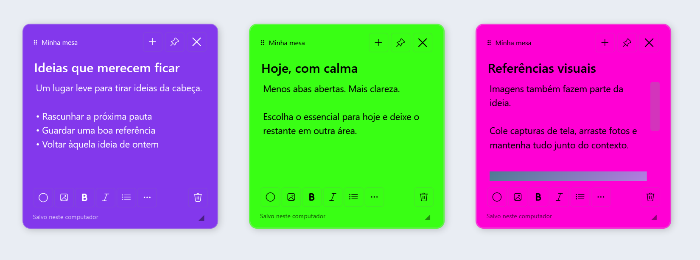
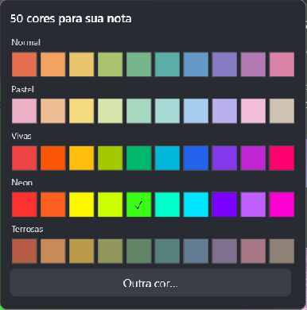

# SMT Sticky Notes

[Releases](https://github.com/showmetech/windows-sticky-notes/releases) · [Privacidade](PRIVACY.md) · [Fluxo de publicação](docs/PUBLISHING.md)

Notas adesivas para Windows 11, com a mesma base visual dos widgets de áudio e calendário: Segoe UI Variable, tema Fluent, cabeçalho de 64 px, ações de 32 px, cantos de 8 px, superfícies sólidas com opacidade padrão de 100% e animação de abertura/recolhimento de 240 ms que respeita as preferências do Windows.

## Widget e configurações

O widget de 360 DIP reúne áreas, busca, notas e lixeira. As configurações usam três seções: Geral, Notas e Google; atalhos e informações da versão ficam na ajuda. A janela se posiciona acima ou ao lado do widget conforme a área útil do monitor. Fontes e controles mantêm o tamanho natural; telas excepcionalmente pequenas usam rolagem acessível. Ctrl+Tab alterna as seções, Ctrl+F busca e Escape limpa a busca antes de recolher.

O alfinete do widget o mantém aberto; o alfinete de cada nota continua independente. Sem fixar, o widget recolhe ao mudar para outro app, após 20 segundos sem interação, ou ao abrir outro widget compatível da suíte. Esse recolhimento não oculta nem exclui as notas da mesa. Enquanto configurações ou o menu estão em uso, o widget permanece aberto. Ao fechar as configurações, começa um novo período de inatividade de 20 segundos. Esc recolhe a janela atual e Ctrl+, abre configurações. Há acesso direto às configurações na faixa superior de cada nota.

A bandeja usa a integração nativa do Windows, com ícone próprio, ativação por mouse/teclado e recriação do ícone após reinício do Explorer. O aplicativo não cria janela principal na barra de tarefas. `--settings` abre as configurações; `--startup` inicia apenas a bandeja.

## Usar

- **Clique no ícone da bandeja:** oculta todas as notas quando alguma está visível; quando todas estão ocultas, mostra as notas da área ativa nas posições salvas. O widget fica no menu do botão direito. Não cria botões na barra de tarefas.
- **Botão direito na bandeja:** nova nota, mostrar/ocultar, notas e áreas, grade, configurações e sair.
- **Arraste pela faixa superior**, ao lado dos botões, para posicionar a nota livremente na área de trabalho. Para redimensionar, passe o mouse por qualquer lateral ou canto e arraste quando aparecer o cursor de ajuste. Laterais alteram um eixo; cantos ajustam largura e altura. Posição e tamanho continuam salvos ao reabrir.
- **Edite o título e pressione Enter para confirmar**, salvar e levar o foco ao corpo, sem inserir uma quebra no título. Escreva no corpo. Ctrl+B e Ctrl+I formatam o texto; o botão de lista insere marcadores.
- **Imagens:** cole com Ctrl+V, arraste um arquivo para o corpo ou use o botão de imagem. A imagem é incorporada à nota: o arquivo original pode ser movido depois. Imagens grandes são reduzidas para até 1.600 pixels de largura; arquivos de até 30 MB. Formatos dependem dos decodificadores presentes no Windows; PNG e JPEG são as opções mais seguras.
- **Cor:** clique na amostra colorida e escolha entre **50 cores**, organizadas em cinco linhas de dez: **Normal**, **Pastel**, **Vivas**, **Neon** e **Terrosas**, ou uma cor personalizada. Vivas e Neon preservam a saturação mesmo no tema escuro; o texto alterna automaticamente entre preto e branco para manter contraste. Cores automáticas evitam as já usadas pelas notas ativas, inclusive as escolhidas manualmente.
- **Alfinete:** mantém a nota acima das outras janelas. Sem fixar, a nota se recolhe ao mudar o foco para outro aplicativo ou para a área de trabalho. Editar outra nota ou usar controles do próprio app não a recolhe.
- **Minimizar (traço) ou Esc:** oculta a nota; não a exclui. O clique na bandeja a traz de volta. Ctrl+Shift+H oculta todas. O topo mostra configurações, nova nota, fixar e minimizar; a base mostra cor, imagem, negrito, itálico, lista e lixeira. Não há menu de três pontos, nome da área ou legenda de salvamento na nota. Um aviso aparece somente se não for possível salvar.
- **Áreas:** crie áreas em Configurações e selecione a área ativa no widget. São grupos próprios do app, não áreas de trabalho virtuais do Windows.
- **Lixeira:** use o botão à direita da barra inferior, alinhado com os demais controles. A exclusão pede confirmação; Cancelar é a ação padrão. A nota só é movida após confirmar “Excluir nota” e pode ser restaurada pelo widget. Esta versão não faz exclusão definitiva nem esvazia a lixeira automaticamente.

## Instalação pela Microsoft Store

Instale ou atualize pela [página oficial SMT Sticky Notes](https://apps.microsoft.com/detail/9PN00KMTMDS1). A Store fornece a arquitetura adequada, assinatura e atualizações pelo canal oficial; mantenha suas atualizações automáticas habilitadas. O app é por usuário e requer Windows 11 em versão suportada, x64 ou ARM64. Não depende da conta do desenvolvedor.

Na edição Store, as notas ficam em `%LOCALAPPDATA%\Packages\Showmetech.ShowmetechStickyNotes_t8ppe5514qkcj\LocalState\notes`. O menu Iniciar mostra SMT Sticky Notes; a execução normal permanece na bandeja. Para manutenção, preserve a identidade instalada e use as atualizações da Store. Não instale um ZIP paralelamente para adiantar a certificação.

## Distribuição alternativa e dados

Na distribuição alternativa ZIP, o aplicativo é instalado por usuário, sem administrador, em `%LOCALAPPDATA%\Programs\WindowsStickyNotes`. A inicialização automática abre apenas a bandeja. É possível desativá-la nas configurações. Há um atalho no menu Iniciar; use `Install.ps1 -DesktopShortcut` para criar também um atalho na área de trabalho. Um atalho do próprio app já existente é atualizado. O ícone Fluent tem três notas coloridas e usa um arquivo versionado nos atalhos para evitar cache antigo.

Escolha o pacote x64 para Intel/AMD ou ARM64 para Windows em ARM. Pacote portátil: extraia o ZIP inteiro e abra `app\WindowsStickyNotes.exe`. Para instalar, execute `Install.ps1` com PowerShell. Os scripts exigem que a política de execução do Windows permita scripts. Se forem bloqueados, use o executável portátil ou use a versão Store; não é necessário desativar proteções. Não é necessário instalar o .NET: o runtime da arquitetura escolhida acompanha o executável. O pacote portátil não tem assinatura digital. A versão Store já está disponível na página oficial. Cada nova atualização ainda passa pela certificação da Microsoft; uma release nova no GitHub não comprova disponibilidade dessa mesma versão na Store.

Na distribuição ZIP, as notas ficam em `%LOCALAPPDATA%\Bruno\WindowsStickyNotes`; a edição Store usa o caminho próprio descrito acima. A conta Google é opcional: conecte a mesma conta nos dois computadores em Configurações → Google. O app usa a pasta privada do Google Drive; veja [sincronização e conflitos](docs/GOOGLE-SYNC.md). Não há telemetria. Não são criptografadas pelo aplicativo; a proteção depende da conta e do disco do Windows. Backups ZIP também contêm os textos e imagens.

O salvamento ocorre após 500 ms sem edição, ao ocultar e ao sair. Gravações são atômicas e mantêm uma cópia anterior `.bak`. Falhas de gravação aparecem na nota e impedem o fechamento normal. Em recuperação de corrupção, o original é preservado. Queda de energia antes do salvamento pode perder a última alteração ainda não gravada.

“Exportar backup completo” cria um ZIP com índice, documentos e cópias anteriores. Para restaurar manualmente: saia pelo menu da bandeja, preserve a pasta atual de dados e extraia o backup nessa pasta. Não há importação gráfica de backup. A desinstalação preserva a pasta de notas.

## Referências de projeto

- [Microsoft Sticky Notes](https://support.microsoft.com/en-us/windows/apps/stickynotes/create-a-sticky-note): edição rápida, cores e imagens.
- [Tidy Button Sticky Notes](https://tidybutton.com/apps/sticky-notes/): janelas independentes, posições persistentes, busca e recuperação.
- [Movimento no Windows](https://learn.microsoft.com/en-us/windows/apps/design/signature-experiences/motion): transições coerentes e resposta ao usuário.

O código local dos widgets existentes foi inspecionado. O componente `SuiteChrome.cs` foi reaproveitado da base do Calendar & Weather; os dados e a execução dos outros aplicativos não foram alterados.

## Código e validação

Fonte em `src/`. Build: `dotnet build src -c Release`. O SDK .NET 10 é necessário apenas para desenvolvimento. Publicação: `dotnet publish src -c Release -r win-x64 --self-contained true -p:PublishSingleFile=true -p:IncludeNativeLibrariesForSelfExtract=true -o app`.

`--self-test --report <caminho>` testa persistência e recuperação em uma pasta temporária. `--data-dir <pasta>` isola dados; `--demo` cria notas demonstrativas somente em uma pasta vazia. `--verify-live <relatorio>` verifica janelas reais e o mesmo handler usado pelo clique na bandeja, em uma pasta isolada. `--inspect` expõe janelas na barra de tarefas exclusivamente para a ferramenta de QA; a execução normal não usa essa opção. `--quit` solicita encerramento seguro da instância correspondente.

O CI disponibiliza relatórios como artefatos da execução, incluindo arquitetura real do processo ARM64. Resultados locais ficam em `verification/` e não são enviados ao repositório. Não se presume teste de reinício físico, remoção física de monitor, instalação MSIX ou todos os modelos de hardware. O clique físico na bandeja não foi automatizado; foram verificados a criação do ícone e o código que esse clique executa. Atualizações feitas nesta fonte devem seguir [o fluxo de publicação](docs/PUBLISHING.md) para manter desktop, GitHub e Store na mesma versão publicada.

## Compatibilidade e privacidade de distribuição

Veja [a matriz e os limites de suporte](docs/COMPATIBILITY.md). O aplicativo não é vinculado à conta ou ao perfil do desenvolvedor. Credenciais pessoais são obtidas somente pelo login opcional de cada usuário; a identidade OAuth pública do app não concede acesso às notas. A release inclui verificações de arquivos privados e padrões conhecidos de tokens; isso não substitui revisão humana nem certificação da Microsoft.

Configurações1.6.0: Geral, Notas e Google; Ctrl+Tab alterna seções e o botão de ajuda reúne atalhos. Ctrl+F busca no widget, Escape limpa antes de recolher. Interface reflow mantém fontes naturais. Consulte docs/fluent2-design.md e as notas de versão para escopo e validação.
